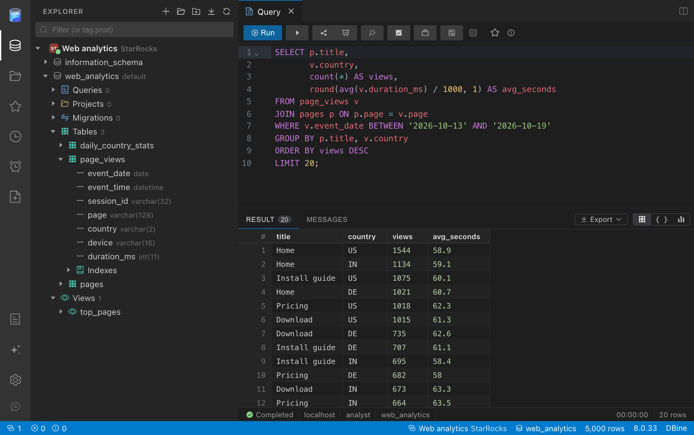

# DBine

[DBine](https://dbine.com) is a free, open source (Apache 2.0 licensed) desktop database manager for
Windows, macOS, and Linux that works with 130+ databases and cloud services in the same window.
It has a StarRocks connection type that connects to the FE over the MySQL protocol.

## Prerequisites

- A running StarRocks cluster reachable from your computer, and its FE query port (MySQL
  protocol, default `9030`).
- DBine, from the [releases page](https://github.com/addlayer-io/dbine/releases).

## Integration

1. In DBine, click **New connection** and select **StarRocks** from the list of engines.
2. Fill in the connection settings:
   - **Server**: your FE hostname or IP address
   - **Port**: the FE query port, `9030` by default
   - **Database**: optional, the database to open first
   - **User** / **Password**: your StarRocks credentials
3. Click **Test connection** to verify, then **Save and connect**.

The connection appears in the **Explorer**. With it you can:

- Browse databases, tables, views, columns, and indexes.
- Right-click a database, choose **New query**, and run SQL with autocompletion. Results can be
  charted and exported to CSV, JSON, XLSX, or SQL.
- View the plan of a query from `EXPLAIN`.
- Create tables in the table designer, with the key model, the distribution, and the number of
  buckets.
- See the running queries of the connected FE, from `SHOW FULL PROCESSLIST`.
- Mark the connection as read-only, so that DBine refuses statements that write.

