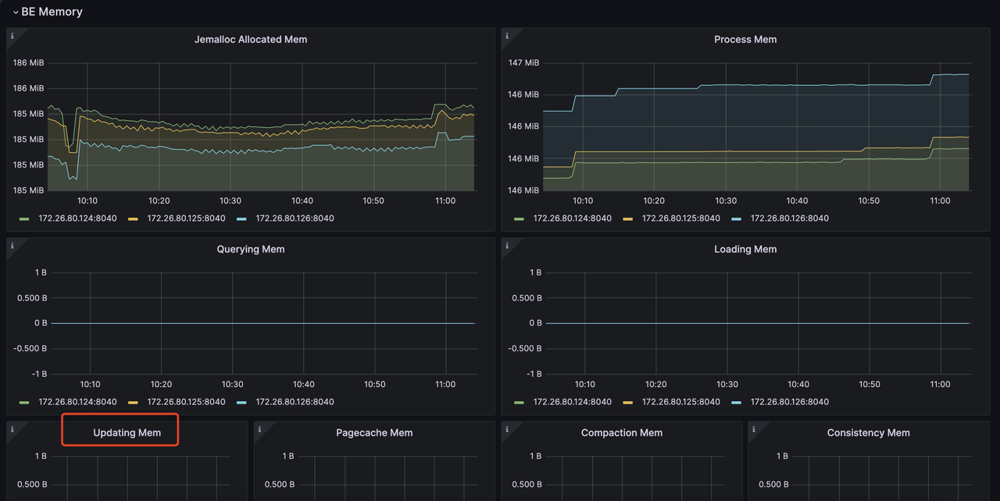

# 主キーテーブル {#primary-key-tables}

主キーテーブルは StarRocks が設計した新しいストレージエンジンを使用しています。その主な利点は、リアルタイムのデータ更新をサポートしながら、複雑なアドホッククエリに対しても効率的なパフォーマンスを確保できる点にあります。リアルタイムのビジネス分析では、意思決定は主キーテーブルの恩恵を受けることができます。主キーテーブルは最新のデータを使用して結果をリアルタイムに分析するため、データ分析におけるデータ遅延を軽減できます。
ただし、主キーは万能というわけではありません。不適切に使用すると、不要なリソースの浪費につながる可能性があります。

そのため、このセクションでは、望ましい結果を得るために、より効率的に主キーモデルを使用する方法について説明します。

## 主キーインデックスの選択 {#choosing-primary-key-index}

主キーインデックスは、主キーテーブルにおいて最も重要なコンポーネントです。主キーインデックスは、主キー値とその主キー値によって特定されるデータ行の位置とのマッピングを格納するために使用されます。

現在、3種類の主キーインデックスをサポートしています：

1. 完全インメモリ主キーインデックス。

```sql
PROPERTIES (
    "enable_persistent_index" = "false"
);
```

2. ローカルディスクベースの永続性主キーインデックス。

```sql
PROPERTIES (
    "enable_persistent_index" = "true",
    "persistent_index_type" = "LOCAL"
);
```

3. クラウドネイティブ永続性主キーインデックス。

```sql
PROPERTIES (
    "enable_persistent_index" = "true",
    "persistent_index_type" = "CLOUD_NATIVE"
);
```

インメモリインデックスの使用は NOT 推奨しません。多くのメモリリソースの浪費につながる可能性があるためです。

共有データ（弾力的）StarRocks クラスタを使用している場合は、cloud ネイティブの永続性主キーインデックスを選択することをお勧めします。ローカルディスクベースの永続性主キーインデックスとは異なり、完全なインデックスデータをリモートオブジェクトストレージに保存し、ローカルディスクはキャッシュとしてのみ機能します。ローカルディスクベースの永続性主キーインデックスと比較した場合の利点は以下の通りです：

1. ローカルディスクの容量に依存しません。
2. データシャードの再バランス後にインデックスを再構築する必要がありません。

## 主キーの選択 {#choosing-the-primary-key}

主キーは通常、クエリの高速化には役立ちません。クエリを高速化するために、`ORDER BY` 句を使用して主キーとは異なる列をソートキーとして指定できます。そのため、主キーを選択する際は、データのインポートおよび更新プロセス中の一意性のみを考慮すればよいです。

主キーが大きいほど、消費するメモリ、I/O、その他のリソースが増えます。そのため、一般的には、主キーとして過度に多くの列や過度に大きな列を選択しないことが推奨されます。主キーのデフォルトの最大サイズは128バイトで、`be.conf` 内の `primary_key_limit_size` パラメータによって制御されます。

`primary_key_limit_size` を増やすことで、より大きな主キーを選択できますが、これによってリソース消費量が増加することに注意してください。

永続性インデックスはどれくらいのストレージ容量とメモリ容量を占有しますか？

### ストレージ容量コストの計算式 {#formula-for-storage-space-cost}

`(key size + 8 bytes) * row count * 50% `

:::note
50%は推定される圧縮効率であり、実際の圧縮効果はデータ自体に依存します。
:::

### メモリコストの計算式 {#formula-for-memory-cost}

`min(l0_max_mem_usage * tablet cnt, update_memory_limit_percent * BE process memory);`

## メモリ使用量 {#memory-usage}

主キーテーブルが使用するメモリは mem_tracker で監視できます：

```
//View the overall memory statistics
http://be_ip:be_http_port/mem_tracker

// View primary key table memory statistics
http://be_ip:be_http_port/mem_tracker?type=update

// View primary key table memory statistics with more details
http://be_ip:be_http_port/mem_tracker?type=update&upper_level=4
```

`mem_tracker` 内の `update` 項目は、主キーインデックスや Delete Vector など、主キーテーブルが使用するメモリ全体を記録します。
この `update` 項目は、メトリクス監視サービス経由でも監視できます。例えば、Grafana では、update 項目を次の方法で確認できます（赤枠内の項目）：



:::tip
詳細は [Prometheus と Grafana による監視およびアラート](../administration/management/monitoring/prometheus_grafana.md) を参照してください
:::

メモリ使用量に敏感で、PKテーブルのインポートプロセス中にメモリ消費を削減したい場合は、次の設定で実現できます：

```sh
be.conf

l0_max_mem_usage = (some value which smaller than 104857600, default is 104857600)

// Shared-nothing cluster
transaction_apply_worker_count = (some value smaller than cpu core number, default is cpu core number)

// Shared-data cluster
transaction_publish_version_worker_count = (some value smaller than cpu core number, default is cpu core number)
```

`l0_max_mem_usage` は、tablet ごとの永続性主キーインデックスの最大メモリ使用量を制御します。`transaction_apply_worker_count` と `transaction_publish_version_worker_count` は、どちらも主キーテーブルでの upsert および delete の処理に使用できる最大スレッド数を制御します。

ただし、`l0_max_mem_usage` を減らすと I/O への負荷が増加する可能性があり、`transaction_apply_worker_count` または `transaction_publish_version_worker_count` を減らすとデータの取り込みが遅くなる可能性があることに注意してください。

## Compaction リソース、データの鮮度、クエリレイテンシのトレードオフ {#tradeoff-between-compaction-resource-data-freshness-and-query-latency}

他のモデルのテーブルと比較して、主キーテーブルはデータのインポート、更新、削除の際に主キーインデックスの検索と Delete Vector の生成という追加の操作が必要となり、これにより追加のリソースオーバーヘッドが発生します。
そのため、以下の3つの要素の間でトレードオフを行う必要があります：

- Compaction リソースの制限。
- データの鮮度
- クエリレイテンシ

#### データの鮮度とクエリレイテンシ {#data-freshness--query-latency}

より良いデータの鮮度とより良いクエリレイテンシの両方を得たい場合、それは高頻度の書き込みを導入することを意味し、さらにそれらができるだけ早く Compaction されることを確保したいということになります。
その場合、これらの書き込みを処理するためにより多くの Compaction リソースが必要になります：

```sh
// shared-data
be.conf
compact_threads = 4

// shared-nothing
be.conf
update_compaction_num_threads_per_disk = 1
update_compaction_per_tablet_min_interval_seconds = 120
```

高頻度の書き込みを処理するためにより多くの Compaction リソースを導入するには、`compact_threads` と `update_compaction_num_threads_per_disk` を増やすか、`update_compaction_per_tablet_min_interval_seconds` を減らすことができます。

現在の Compaction リソースと設定が現在の高頻度書き込みを処理できるかどうかは、どのようにして分かりますか？次の方法で確認できます：

1. 共有データクラスタでは、Compaction がデータ取り込み速度に追いつけない場合、取り込みの遅延や、さらには書き込み失敗エラーや取り込みの停止につながる可能性があります。
a. 取り込みの遅延。
`show proc /transactions/{db_name}/running';` を使用して現在実行中のトランザクションを確認でき、以下のような遅延メッセージがある場合：

   ```sh
   Partition's compaction score is larger than 100.0, delay commit for xxxms. You can try to increase compaction concurrency
   ```

ErrMsg フィールドに表示されている場合、それは取り込みの遅延が発生していることを意味します。
例：

```sql
show proc '/transactions/test_pri_load_c/running';
```

```plain
+---------------+----------------------------------------------+------------------+-------------------+--------------------+---------------------+------------+-------------+------------+----------------------------------------------------------------------------------------------------------------------------+--------------------+------------+-----------+--------+
| TransactionId | Label                                        | Coordinator      | TransactionStatus | LoadJobSourceType  | PrepareTime         | CommitTime | PublishTime | FinishTime | Reason                                                                                                                     | ErrorReplicasCount | ListenerId | TimeoutMs | ErrMsg |
+---------------+----------------------------------------------+------------------+-------------------+--------------------+---------------------+------------+-------------+------------+----------------------------------------------------------------------------------------------------------------------------+--------------------+------------+-----------+--------+
| 1034          | stream_load_d2753fbaa0b343acadd5f13de92d44c1 | FE: 172.26.94.39 | PREPARE           | FRONTEND_STREAMING | 2024-10-24 13:05:01 | NULL       | NULL        | NULL       | Partition's compaction score is larger than 100.0, delay commit for 6513ms. You can try to increase compaction concurrency, | 0                  | 11054      | 86400000  |        |
+---------------+----------------------------------------------+------------------+-------------------+--------------------+---------------------+------------+-------------+------------+----------------------------------------------------------------------------------------------------------------------------+--------------------+------------+-----------+--------+
```

b. 取り込みの停止。
以下のような取り込みエラーが発生している場合：

```
Failed to load data into partition xxx, because of too large compaction score, current/limit: xxx/xxx. You can reduce the loading job concurrency, or increase compaction concurrency 
```

これは、コンパクションが現在の高頻度の書き込みに追いつけないため、データ取り込みが停止することを意味します。

2. 共有なしクラスタの場合、データ取り込みの速度低下戦略はありません。コンパクションが現在の高頻度の書き込みに追いつけない場合、データ取り込みは失敗し、以下のエラーメッセージが返されます：

```
Failed to load data into tablet xxx, because of too many versions, current/limit: xxx/xxx. You can reduce the loading job concurrency, or increase loading data batch size. If you are loading data with Routine Load, you can increase FE configs routine_load_task_consume_second and max_routine_load_batch_size.
```

#### データの鮮度と Compaction リソースの制限 {#data-freshness--compaction-resources-limitation}

コンパクションリソースが限られているにもかかわらず、十分なデータの鮮度を維持する必要がある場合、クエリレイテンシーをある程度犠牲にする必要があります。

それを実現するために、以下の設定変更を行うことができます：

- 共有データクラスタ

```
fe.conf

lake_ingest_slowdown_threshold = xxx (default is 100, you can increase it)
lake_compaction_score_upper_bound = xxx (default is 2000, you can increase it)
```

`lake_ingest_slowdown_threshold` パラメータは、データ取り込みの速度低下をトリガーするしきい値を制御します。パーティションのコンパクションスコアがこのしきい値を超えると、システムはデータ取り込みの速度を低下させ始めます。同様に、`lake_compaction_score_upper_bound` はデータ取り込みの停止をトリガーするしきい値を決定します。

- 共有なしクラスタ

```
be.conf

tablet_max_versions = xxx (default is 1000, you can increase it)
```

`tablet_max_versions` は、データ取り込みの停止をトリガーするしきい値を決定します。

これらの設定を大きくすることで、システムはより多くの小さなデータファイルを許容し、コンパクションの頻度を減らすことができますが、クエリレイテンシーにも影響します。

#### クエリレイテンシーと Compaction リソースの制限 {#query-latency--compaction-resources-limitation}

限られたコンパクションリソースで良好なクエリレイテンシーを実現したい場合は、書き込み頻度を減らし、データ取り込みのためのより大きなデータバッチを作成する必要があります。

具体的な実装については、データ取り込みの頻度を減らし、バッチサイズを増やす方法を詳しく説明している、各種データ取り込み方法のセクションを参照してください。
