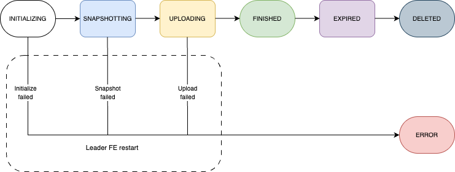

<head><meta name="docsearch:pagerank" content="100"/></head>

import Beta from '../../_assets/commonMarkdown/_beta.mdx'

# 集群快照

<Beta />

本文介绍如何在存算分离集群上使用集群快照进行灾难恢复。

此功能从 v3.4.2 开始支持，并且仅在存算分离集群上可用。

## 概述

存算分离集群的灾难恢复的基本思想是确保完整的集群状态（包括数据和元数据）存储在对象存储中。这样，如果集群发生故障，只要数据和元数据保持完整，就可以从对象存储中恢复。此外，云提供商提供的备份和跨区域复制等功能可以用于实现远程恢复和跨区域灾难恢复。

在存算分离集群中，CN 状态（数据）存储在对象存储中，但 FE 状态（元数据）仍然是本地的。为了确保对象存储中拥有所有用于恢复的集群状态，StarRocks 现在支持集群快照以保存数据和元数据。

### 工作流程



### 术语

- **集群快照**

  集群快照是指在某一时刻的集群状态的快照。它包含集群中的所有对象，如 catalogs、数据库、表、用户和权限、导入任务等。它不包括所有外部依赖对象，如 external catalog 的配置文件和本地 UDF JAR 包。

- **生成集群快照**

  系统自动维护紧随最新集群状态的快照。在创建最新快照后，历史快照将被删除，始终只保留一个快照。

- **集群恢复**

  从快照中恢复集群。

## 自动化集群快照

自动化集群快照默认是禁用的。

使用以下语句启用此功能：

语法：

```SQL
ADMIN SET AUTOMATED CLUSTER SNAPSHOT ON
[INTERVAL <value> <unit>]
[STORAGE VOLUME <storage_volume_name>]
```

参数：

`INTERVAL <value> <unit>`：自动创建快照的时间间隔。`value` 必须为正整数，`unit` 必须为 `SECOND`、`MINUTE`、`HOUR`、`DAY` 或 `WEEK`。如果未指定此参数，则由 FE 配置项 `automated_cluster_snapshot_interval_seconds` 控制时间间隔。

`storage_volume_name`：指定用于存储快照的存储卷。如果未指定此参数，将使用内置存储卷 `builtin_storage_volume`，即使已将其他存储卷设置为默认存储卷。如果 `builtin_storage_volume` 不存在（例如 `enable_load_volume_from_conf` 为 `false`），该语句将失败，您必须指定存储卷。有关创建存储卷的详细信息，请参阅 [CREATE STORAGE VOLUME](../../sql-reference/sql-statements/cluster-management/storage_volume/CREATE_STORAGE_VOLUME.md)。

每当距上一次自动快照开始的时间达到快照时间间隔时，Leader FE 会执行一次元数据检查点以创建新的元数据镜像，并基于该镜像创建快照。快照的名称由系统生成，格式为 `automated_cluster_snapshot_{timestamp}`。

元数据快照存储在 `/{storage_volume_locations}/{service_id}/meta/image/automated_cluster_snapshot_timestamp` 下。数据快照存储在与原始数据相同的位置。

如果启用该功能时未指定 `INTERVAL`，则由 FE 配置项 `automated_cluster_snapshot_interval_seconds` 控制快照自动化周期。默认值为 600 秒（10 分钟）。

在功能启用期间，可以使用以下语句修改时间间隔（该语句与 `INTERVAL` 子句均自 v4.0.5 起支持）：

```SQL
ADMIN ALTER AUTOMATED CLUSTER SNAPSHOT SET INTERVAL <value> <unit>
```

使用以下语句查看该功能是否启用、生效的时间间隔、存储卷，以及上一次和下一次快照的时间（自 v4.0.6 起支持）：

```SQL
ADMIN SHOW AUTOMATED CLUSTER SNAPSHOT
```

### 禁用自动化集群快照

使用以下语句禁用自动化集群快照：

```SQL
ADMIN SET AUTOMATED CLUSTER SNAPSHOT OFF
```

一旦禁用自动化集群快照，系统将自动清除历史快照。

## 查看集群快照

您可以查询视图 `information_schema.cluster_snapshots` 来查看最新的集群快照和尚未删除的快照。

```SQL
SELECT * FROM information_schema.cluster_snapshots;
```

返回：

| 字段              | 描述                                                  |
| ------------------ | ------------------------------------------------------------ |
| snapshot_name      | 快照的名称。                                    |
| snapshot_type      | 快照的类型。当前该值始终为 `AUTOMATED`。 |
| created_time       | 快照创建的时间。                  |
| fe_journal_id      | FE 日志的 ID。                                    |
| starmgr_journal_id | StarManager 日志的 ID。                           |
| properties         | 应用于尚未可用的功能。                      |
| storage_volume     | 存储快照的存储卷。             |
| storage_path       | 存储快照的存储路径。         |

## 查看集群快照任务

您可以查询视图 `information_schema.cluster_snapshot_jobs` 来查看集群快照的任务信息。

```SQL
SELECT * FROM information_schema.cluster_snapshot_jobs;
```

返回：

| 字段              | 描述                                                  |
| ------------------ | ------------------------------------------------------------ |
| snapshot_name      | 快照的名称。                                    |
| job_id             | 任务的 ID。                                           |
| created_time       | 任务创建的时间。                       |
| finished_time      | 任务完成的时间。                      |
| state              | 任务的状态。有效值：`INITIALIZING`、`SNAPSHOTING`、`FINISHED`、`EXPIRED`、`DELETED` 和 `ERROR`。 |
| detail_info        | 当前执行阶段的具体进度信息。 |
| error_message      | 任务的错误信息（如果有）。                       |

## 恢复集群

按照以下步骤使用集群快照恢复集群。

1. **（可选）** 若需在当前区域内执行跨集群恢复，必须修改 Leader FE 节点 `fe/conf` 目录下的配置文件 **cluster_snapshot.yaml**。否则可跳过此步骤。

   要将数据恢复到新集群，必须将原始存储路径下的所有文件复制到新路径。请务必使用[附录](#附录)中提供的模板。

2. 启动 Leader FE 节点。

   ```Bash
   ./fe/bin/start_fe.sh --cluster_snapshot --daemon
   ```

3. **清理 `meta` 目录后** 启动其他 FE 节点。

   ```Bash
   ./fe/bin/start_fe.sh --helper <leader_ip>:<leader_edit_log_port> --daemon
   ```

   将节点添加至集群。

   ```SQL
   -- 添加 Follower 节点：
   ALTER SYSTEM ADD FOLLOWER "<follower_host>:<follower_edit_log_port>";
   
   -- 添加 Observer 节点：
   ALTER SYSTEM ADD OBSERVER "<observer_host>:<observer_edit_log_port>";
   ```

4. **清理 `storage_root_path` 目录后** 启动 CN 节点。

   ```Bash
   ./be/bin/start_cn.sh --daemon
   ```

   将节点添加至集群。

   ```SQL
   ALTER SYSTEM ADD COMPUTE NODE "<cn_host>:<cn_heartbeat_service_port>";
   ```

如果您在步骤 1 中修改了 **cluster_snapshot.yaml**，节点和存储卷将根据文件中的信息在新集群中重新配置。

## 附录

跨集群恢复使用的 **cluster_snapshot.yaml** 模板：

```Yaml
# 要下载以进行恢复的集群快照的信息。
cluster_snapshot:
    # 快照的 URI。
    # 示例 1: s3://defaultbucket/test/f7265e80-631c-44d3-a8ac-cf7cdc7adec811019/meta/image/automated_cluster_snapshot_1704038400000
    # 示例 2: s3://defaultbucket/test/f7265e80-631c-44d3-a8ac-cf7cdc7adec811019/meta
    cluster_snapshot_path: <cluster_snapshot_uri>
    # 存储快照的存储卷名称。您必须在 `storage_volumes` 部分中定义它。
    # 注意：它必须与原始集群中的相同。
    storage_volume_name: my_s3_volume

# [可选] 要恢复快照的新集群的节点信息。
# 如果未指定此部分，恢复后的新集群仅具有 Leader FE 节点。
# CN 节点保留原始集群的信息。
# 注意：不要在此部分中包含 Leader FE 节点。

frontends:
    # FE 主机。
  - host: xxx.xx.xx.x1
    # FE edit_log_port。
    edit_log_port: 9010
    # FE 节点类型。有效值：`follower`（默认）和 `observer`。
    type: follower
  - host: xxx.xx.xx.x2
    edit_log_port: 9010
    type: observer

compute_nodes:
    # CN 主机。
  - host: xxx.xx.xx.x3
    # CN heartbeat_service_port。
    heartbeat_service_port: 9050
  - host: xxx.xx.xx.x4
    heartbeat_service_port: 9050

# 新集群中存储卷的信息。用于恢复克隆的快照。
# 注意：存储卷的名称必须与原始集群中的相同。
storage_volumes:
  # S3 兼容存储卷的示例。
  - name: my_s3_volume
    type: S3
    location: s3://defaultbucket/test/
    comment: my s3 volume
    properties:
      - key: aws.s3.region
        value: us-west-2
      - key: aws.s3.endpoint
        value: https://s3.us-west-2.amazonaws.com
      - key: aws.s3.access_key
        value: xxxxxxxxxx
      - key: aws.s3.secret_key
        value: yyyyyyyyyy
  # HDFS 存储卷的示例。
  - name: my_hdfs_volume
    type: HDFS
    location: hdfs://127.0.0.1:9000/sr/test/
    comment: my hdfs volume
    properties:
      - key: hadoop.security.authentication
        value: simple
      - key: username
        value: starrocks
```

:::note
有关 AWS 认证信息的更多信息，请参阅 [配置 AWS 认证信息](../../integrations/csp_auth/authenticate_to_aws_resources.md)。
:::

## 限制

- 目前不支持待机模式。Primary 集群和 Secondary 集群不能同时在线，否则无法保证 Secondary 集群的正常运行。
- 目前仅能保留一个自动集群快照。
