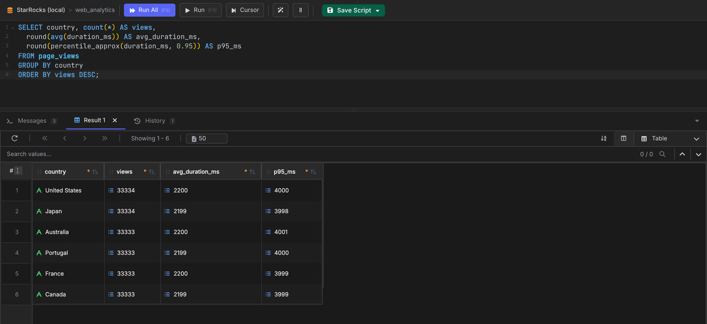

# VisuaLeaf

[VisuaLeaf](https://visualeaf.com/) 是一款适用于 Windows、macOS 和 Linux 的桌面数据库客户端，提供带结果网格的 SQL 编辑器、可视化查询构建器、ER 图，以及基于查询结果生成图表等功能。VisuaLeaf 没有专门的 StarRocks 连接类型，而是使用其 **MySQL** 连接类型，通过 MySQL 协议连接 StarRocks。

## 前提条件

- 一个正在运行、且可从 VisuaLeaf 所在机器访问的 StarRocks 集群，以及其 FE 查询端口（MySQL 协议，默认为 `9030`）。
- VisuaLeaf 本身。您可以在 [https://visualeaf.com/download](https://visualeaf.com/download) 下载。VisuaLeaf 提供免费的社区版以及付费版本。

VisuaLeaf 是桌面应用程序。如果 StarRocks 在同一台机器的 Docker 中运行，请将 FE 查询端口发布到主机，然后连接 `localhost`：

```sh
docker run -p 9030:9030 -p 8030:8030 starrocks/allin1-ubuntu
```

在此设置下，请在下面的连接设置中使用 `localhost` 作为主机、`9030` 作为端口。

## 集成

1. 启动 VisuaLeaf，点击 **New Connection**。
2. 搜索 `mysql`，选择 **MySQL** 作为连接类型。StarRocks 兼容 MySQL 协议，因此无需选择单独的 StarRocks 连接类型。
3. 填写连接设置：
   - **Host**：FE 的主机名或 IP 地址（如果 StarRocks 按上述方式在 Docker 中运行并发布了端口，则为 `localhost`）
   - **Port**：FE 查询端口，默认为 `9030`（而不是 MySQL 的 `3306`）
   - **Database**：目标数据库名称
   - **User** / **Password**：您的 StarRocks 凭据，例如 `root`（默认无密码）
4. 点击 **Test Connection** 验证设置，然后点击 **Save & Connect**。
5. 在 **Connections** 侧边栏中展开该连接，即可看到集群中的数据库及其表和视图。
6. 右键单击某个数据库并选择 **New SQL Editor**。编写查询后，按 **F5** 运行全部语句（**Run All**），或按 **F9** 仅运行选中的文本（**Run**）。结果显示在编辑器下方的结果网格中。


